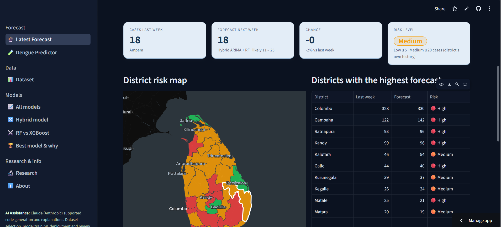
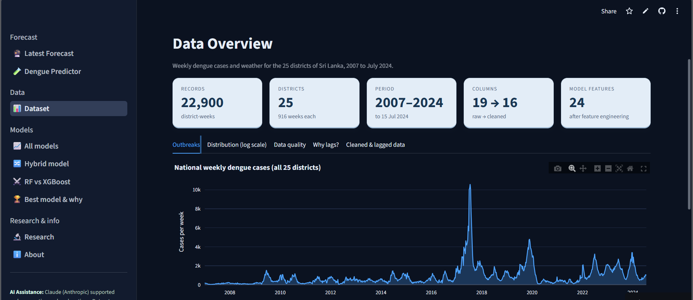

# 🦟 Sri Lanka Dengue Risk Prediction

Weekly, district-level dengue forecasting for Sri Lanka, comparing ensemble learning and hybrid models.

[](https://dengue-prediction-ensemble.streamlit.app/)
[](https://colab.research.google.com/github/ChiraniSiriwardhana/SL-DenguePrediction-dashboard/blob/main/notebooks/Sri_Lanka_Dengue_Ensemble_Learning.ipynb)

| | Link |
|---|---|
| 📊 Live dashboard | https://dengue-prediction-ensemble.streamlit.app/ |
| 📓 Notebook (Colab) | https://colab.research.google.com/github/ChiraniSiriwardhana/SL-DenguePrediction-dashboard/blob/main/notebooks/Sri_Lanka_Dengue_Ensemble_Learning.ipynb |
| 🗂️ Dataset | [`data/Sri_Lanka_Dengue_Dataset.csv`](data/Sri_Lanka_Dengue_Dataset.csv) |

(Free Streamlit apps sleep when unused. If you see a "wake up" button, press it and wait a minute.)

> ⚠️ **Disclaimer.** This is a university research project. Its estimates are **not** official health warnings and do not confirm an outbreak. For official information, contact the Ministry of Health or the National Dengue Control Unit.

---

## What it is




Using weekly dengue cases and weather data for Sri Lanka's 25 districts (2007 to July 2024), the project predicts reported dengue cases for the **next week**.

- **Notebook:** prepares data, trains and evaluates the models (Naive, Linear Regression, ARIMA, Random Forest, XGBoost, LightGBM, CatBoost, Stacking, Hybrid ARIMA + Random Forest).
- **Dashboard (`app.py`):** shows the results and offers a what-if prediction page.

## Folder structure

```
SL-DenguePrediction-dashboard/
├── app.py
├── requirements.txt
├── notebooks/
│   └── Sri_Lanka_Dengue_Ensemble_Learning.ipynb
├── .streamlit/config.toml
├── data/
│   └── Sri_Lanka_Dengue_Dataset.csv
├── sri_lanka_districts.geojson
├── outputs/                  # results created by the notebook
│   ├── predictions.csv, model_comparison.csv, risk_thresholds.csv,
│   ├── forecast_next_week.csv, training_time.csv,
│   └── district_week_profile.csv, whatif_backtest.csv
└── models/                   # trained models for the Dengue Predictor
    ├── rf_model.joblib
    ├── catboost_model.cbm
    └── predictor_params.json
```

## Run the notebook

**Recommended: Google Colab.** Open the Colab link above, sign in, click **Run anyway** on the "not authored by Google" warning, then run **Runtime → Run all** (or run cells one by one with Shift+Enter). The notebook installs its libraries and loads the data from GitHub automatically. It takes several minutes.

**Locally (VS Code / Jupyter):** clone the repo, run `pip install -r requirements.txt` plus `statsmodels xgboost lightgbm matplotlib seaborn jupyter ipykernel`, open the notebook and run the cells top to bottom. An internet connection is required, because the data is loaded from GitHub. The Colab-only download cells in Section 15 are skipped locally.

## Dataset

Stored at `data/Sri_Lanka_Dengue_Dataset.csv` (keep this name and folder).
Source: [rajaththomson/sri-lanka-dengue-fever-analysis](https://github.com/rajaththomson/sri-lanka-dengue-fever-analysis). Please check its terms of use.

```python
import pandas as pd

URL = "https://raw.githubusercontent.com/ChiraniSiriwardhana/SL-DenguePrediction-dashboard/refs/heads/main/data/Sri_Lanka_Dengue_Dataset.csv"
df = pd.read_csv(URL)   # or pd.read_csv("data/Sri_Lanka_Dengue_Dataset.csv") from a clone
df["Week_Start_Date"] = pd.to_datetime(df["Week_Start_Date"], format="%m/%d/%Y")
df = df.sort_values(["District", "Week_Start_Date"]).reset_index(drop=True)
```

## Run the dashboard locally

Requires Python 3.10+ and Git.

```bash
git clone https://github.com/ChiraniSiriwardhana/SL-DenguePrediction-dashboard.git
cd SL-DenguePrediction-dashboard
python -m venv .venv
# Windows: .venv\Scripts\activate   |   macOS/Linux: source .venv/bin/activate
pip install -r requirements.txt
streamlit run app.py
```

Opens at http://localhost:8501. No training needed; result files and trained models are included.

**Troubleshooting**
- *Error loading `rf_model.joblib`:* install the scikit-learn version printed by the notebook's export cell (`pip install scikit-learn==<version>`) and use it in `requirements.txt`.
- *"File not found":* check that the files in the folder structure are next to `app.py` (or in `data/`).
- *Dengue Predictor error:* it needs `rf_model.joblib`, `predictor_params.json`, `district_week_profile.csv`, `whatif_backtest.csv` and `catboost_model.cbm`.

## Requirements (dashboard)

```
streamlit>=1.50
pandas
numpy
plotly>=5.24
joblib
scikit-learn
catboost
```

## Recreate result and model files

1. Run the whole notebook.
2. Run the export cells at the end (they create the result and Dengue Predictor files and check the saved models).
3. Copy the files into the repo next to `app.py` and restart the dashboard.

## Deploy your own copy

Fork the repo, go to [share.streamlit.io](https://share.streamlit.io), choose **Create app → Deploy a public app from GitHub**, select your fork, branch `main`, file `app.py`, then **Deploy**.

## Method in brief

- **Cleaning:** removed the duplicate rainfall and sunrise/sunset columns (19 → 16 columns).
- **Target:** reported cases in the next week.
- **Features (24):** current cases, case lags (1, 2, 4, 8, 12 weeks), 4-week average, weather, rainfall and temperature lags and totals, week of year (sin, cos), district. Only past information is used.
- **Split (chronological):** train 2007-03-26 to 2020-12-28, validation 2021–2022, test 2023-01-02 to 2024-07-08. Hyperparameters were chosen on the validation set. Weight-constrained stacking was added after the first Ridge stacking performed poorly on the test set; both are reported.
- **Metrics:** MAE, RMSE, R². MAPE only on weeks with at least one case (about 13% of weeks have zero).

## Limitations

- Data end in July 2024. This is a demonstration, not live surveillance.
- The **Dengue Predictor** fills 16 of 24 features with district-week averages. It is a what-if tool, not a validated forecast.
- Models predict *reported* cases, not true infections. Large outbreaks are hard to predict, and tree models cannot go beyond case numbers seen in training.
- The test period has more cases than training (distribution shift), so test errors are larger.
- Nothing here is an official health warning.

## Acknowledgements

Data: [rajaththomson](https://github.com/rajaththomson/sri-lanka-dengue-fever-analysis). District boundaries: [Natural Earth](https://www.naturalearthdata.com/) (public domain). Tools: Google Colab, scikit-learn, XGBoost, LightGBM, CatBoost, statsmodels, Streamlit, Plotly.
